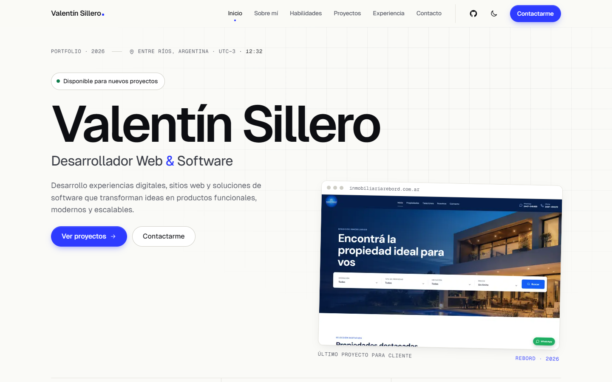
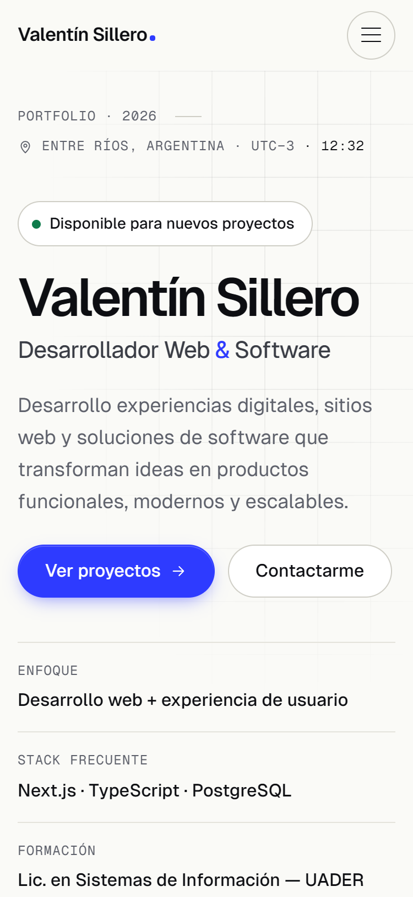
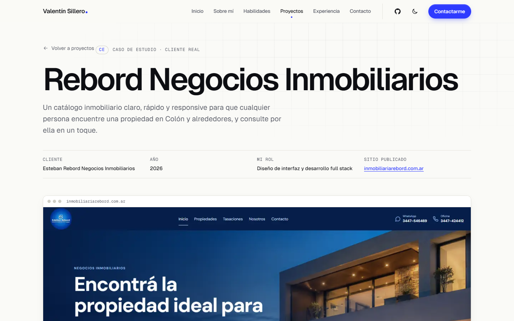
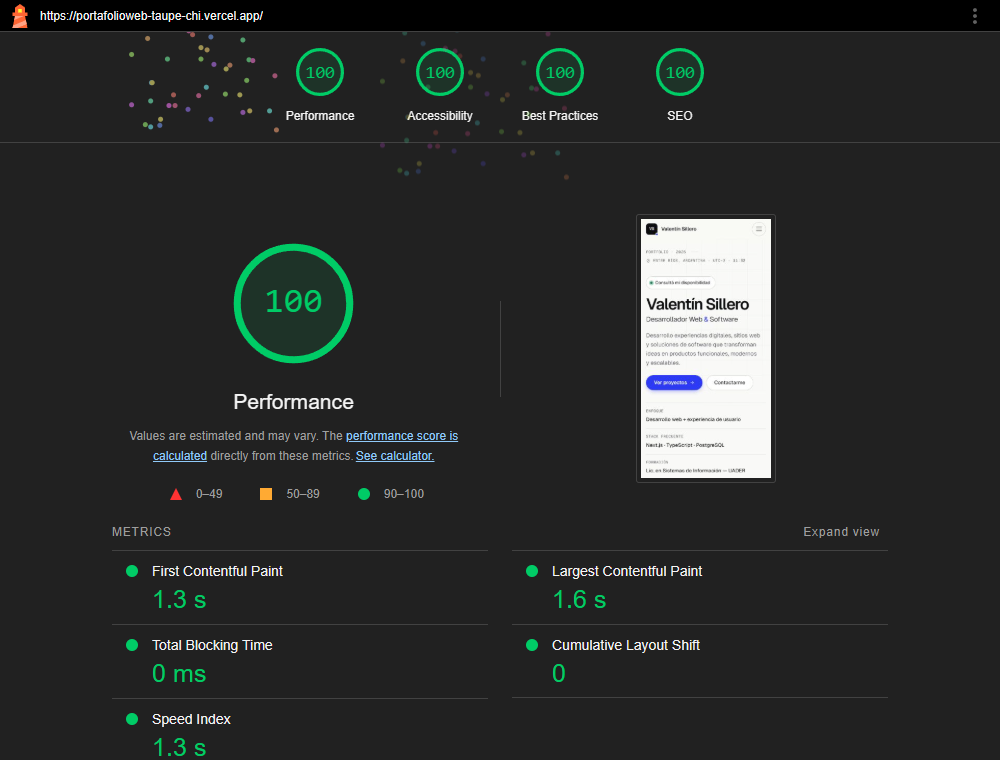

# Valentín Sillero — Portfolio

Portfolio personal de **Valentín Sillero**, desarrollador web y de software de Entre Ríos, Argentina. Trabajo Final de **Diseño UX/UI 2026** — Licenciatura en Sistemas de Información, UADER · FCyT (docente: Mg. Ernesto Ledesma).

Concepto visual: **“Precisión digital”**, un portfolio claro y editorial con lenguaje de plano técnico, que presenta tres proyectos reales: un desarrollo para cliente (Rebord Negocios Inmobiliarios), un producto propio (DEETA) y un proyecto académico de UX/UI (Cubrí Seguros).

| | |
|---|---|
| **Sitio publicado** | [portafolioweb-taupe-chi.vercel.app](https://portafolioweb-taupe-chi.vercel.app) |
| **Repositorio** | [github.com/ValentinSillero/PortafolioWeb](https://github.com/ValentinSillero/PortafolioWeb) |
| **Figma** (research, wireframes, design system, prototipo) | [figma.com/design/3AxCDCuNJOfTUIWiVaQyt2](https://www.figma.com/design/3AxCDCuNJOfTUIWiVaQyt2) |
| **Proceso UX/UI (PDF, 10 slides)** | [`docs/presentacion/Proceso_UXUI_Valentin_Sillero.pdf`](docs/presentacion/Proceso_UXUI_Valentin_Sillero.pdf) |
| **Lighthouse mobile** | [`docs/lighthouse/`](docs/lighthouse/) |

## Capturas

| Desktop (1440) | Mobile (375) |
|---|---|
|  |  |

Caso de estudio: 

## Stack

- **HTML5 semántico** (`header`, `nav`, `main`, `section` con `id`, `article`, `footer`, `dialog`).
- **CSS3 puro** con variables en `:root` (design system), Flexbox y CSS Grid, mobile-first.
- **JavaScript vanilla** (≈ 9 KB sin minificar): menú mobile accesible, tema claro/oscuro, sección activa, animaciones de entrada, contador de métricas, reloj local, copiar email y modales.
- **Tipografías:** Geist y Geist Mono (OFL), auto-hospedadas con `font-display: swap`.
- **Hosting:** Vercel, deploy automático desde GitHub.
- Sin frameworks, sin dependencias de runtime, sin paso de build.

## Estructura

```
├── index.html               One-page con las 9 secciones
├── caso-rebord.html         Caso de estudio UX/UI (página interna)
├── 404.html                 Página 404 personalizada
├── assets/
│   ├── css/styles.css       Design system + estilos (tokens en :root)
│   ├── js/theme.js          Aplica el tema guardado antes de pintar
│   ├── js/main.js           Interacciones
│   ├── fonts/               Geist + Geist Mono (woff2 variables) + licencia OFL
│   └── img/                 Capturas reales en WebP, og-image
├── favicon.svg · *.png · site.webmanifest · robots.txt · sitemap.xml
├── vercel.json              Headers de seguridad y caché
└── docs/                    Proceso UX/UI (no se publica: ver .vercelignore)
    ├── 01-investigacion.md      Usuario, proto-persona, escenario, benchmark, moodboard
    ├── 02-arquitectura-informacion.md  Sitemap, jerarquía, card sorting
    ├── 03-wireframes.md         Wireframes mobile y desktop
    ├── 04-design-system.md      Paleta, tipografía, espaciado, grilla, componentes
    ├── 05-figma.md              Qué contiene el archivo de Figma
    ├── 06-test-usabilidad.md    Guion, test con 3 personas, hallazgos y cambios aplicados
    ├── 07-commits-y-despliegue.md  Plan de commits y pasos de deploy
    ├── PENDIENTES.md            Lo que falta antes de entregar
    ├── design/                  Fuentes HTML de moodboard, wireframes y design system
    ├── img/                     Capturas y tableros exportados
    ├── lighthouse/              Reportes HTML/JSON + capturas
    └── presentacion/            Presentación (HTML + PDF)
```

## Cómo ejecutarlo localmente

Es un sitio estático: cualquier servidor sirve. Desde la carpeta del proyecto:

```bash
python -m http.server 5173
```

Abrir `http://localhost:5173`. (Las rutas son absolutas, `/assets/...`, por eso conviene un servidor y no abrir el archivo con doble clic.)

## Despliegue (GitHub → Vercel)

1. Repositorio público en GitHub con la rama `main`.
2. En [vercel.com/new](https://vercel.com/new): **Import Git Repository** → elegir el repo.
3. **Framework Preset: Other**, sin Build Command y sin Output Directory (se sirve la raíz).
4. **Deploy.** Vercel publica con HTTPS y vuelve a desplegar en cada `git push` a `main` (CI/CD); cada pull request genera una URL de preview.
5. Las URLs canónicas, Open Graph, `robots.txt` y `sitemap.xml` apuntan a `https://portafolioweb-taupe-chi.vercel.app`. Si se agrega un dominio propio, actualizarlas ahí.

`vercel.json` agrega headers de seguridad (Content-Security-Policy sin `unsafe-inline`, HSTS, X-Frame-Options, X-Content-Type-Options, Referrer-Policy, Permissions-Policy) y caché por tipo de recurso. Detalle de comandos y commits sugeridos en [`docs/07-commits-y-despliegue.md`](docs/07-commits-y-despliegue.md).

## Decisiones técnicas

- **CSS puro en lugar de Tailwind:** el design system vive en variables CSS (`:root`) que también documenta Figma; sin build ni CDN; una sola hoja de ~49 KB sin minificar que Vercel sirve comprimida. La consigna admite “CSS3 y/o Tailwind”.
- **Tipografías auto-hospedadas:** evitan conexiones a terceros, permiten una CSP estricta y mejoran el LCP. Se precarga solo Geist.
- **Imágenes:** capturas reales de los sitios publicados, convertidas a **WebP** (16–47 KB), con `width`/`height` explícitos, `srcset` y `loading="lazy"` debajo del pliegue.
- **Sin scripts inline:** el tema se aplica con `theme.js` en el `<head>` (evita el parpadeo) y permite `script-src 'self'`.
- **Accesibilidad:** un solo `h1`, jerarquía sin saltos, link “Saltar al contenido”, foco visible, menú con `aria-expanded`/`aria-controls`, cierre con Esc y foco atrapado, `<dialog>` nativo para los modales, `aria-current` en la navegación, contraste AA verificado en modo claro y oscuro, `prefers-reduced-motion` y `forced-colors`.
- **Caso de estudio en página propia** (no modal): compartible, indexable y legible con calma. DEETA y Cubrí tienen un modal de detalle.
- **Datos honestos:** cada métrica indica su fuente, y lo que no se registró (por ejemplo, tiempos en el test de usabilidad) se aclara en vez de inventarse.
- **Validación con usuarios:** test con 3 personas (computadora y celular) sobre el sitio publicado; sus hallazgos llevaron a tarjetas más breves, acciones de proyecto diferenciadas y una revisión de la visibilidad del contacto. Detalle en [`docs/06-test-usabilidad.md`](docs/06-test-usabilidad.md).
- **Bonus de la rúbrica:** modo oscuro/claro con toggle y `prefers-color-scheme`, página 404 propia, headers de seguridad, animaciones accesibles.

## Resultados de Lighthouse (mobile)

Medido el 9/11/2026 sobre el sitio publicado en Vercel (Lighthouse 12, emulación mobile):

| Página | Performance | Accessibility | Best Practices | SEO | LCP | CLS |
|---|---|---|---|---|---|---|
| `/` | 100 | 100 | 100 | 100 | 1.6 s | 0 |
| `/caso-rebord.html` | 100 | 100 | 100 | 100 | 1.6 s | 0 |



Reportes completos en [`docs/lighthouse/`](docs/lighthouse/) (`lh-mobile-vercel-*.report.html`). También quedan los del build local (98/100/100/100), sin la compresión ni la caché de Vercel.

## Recursos y créditos

- Tipografías [Geist y Geist Mono](https://vercel.com/font) — Vercel, SIL Open Font License 1.1 (`assets/fonts/OFL-Geist.txt`).
- Íconos: dibujados a mano como SVG de línea para este sitio (el ícono de GitHub y LinkedIn son las marcas de cada servicio).
- Capturas de proyectos: tomadas de los sitios publicados [inmobiliariarebord.com.ar](https://www.inmobiliariarebord.com.ar/), [deetaia.vercel.app](https://deetaia.vercel.app/) y [contratacionseguros.vercel.app](https://contratacionseguros.vercel.app/).
- Benchmark (solo en `docs/`, con fines de análisis académico): [brittanychiang.com](https://brittanychiang.com), [leerob.com](https://leerob.com), [rauno.me](https://rauno.me).
- Herramientas: WebAIM Contrast Checker (fórmula WCAG), Lighthouse, Chrome headless para capturas, sharp para convertir a WebP.
- **No se usó ningún template** como punto de partida: diseño y código propios.

## Uso de IA

Siguiendo la política de la cátedra, declaro que usé **Claude (Anthropic)** como asistente para generar código y borradores de documentación a partir de mis indicaciones, y para tareas técnicas de apoyo. El contenido, los proyectos, los datos y las decisiones de diseño son míos: revisé y corregí el resultado, verifiqué la información publicada y realicé el test de usabilidad con tres personas.

## Licencia

Código © 2026 Valentín Sillero. Las capturas de Rebord pertenecen a su cliente y se muestran con fines de portfolio.
